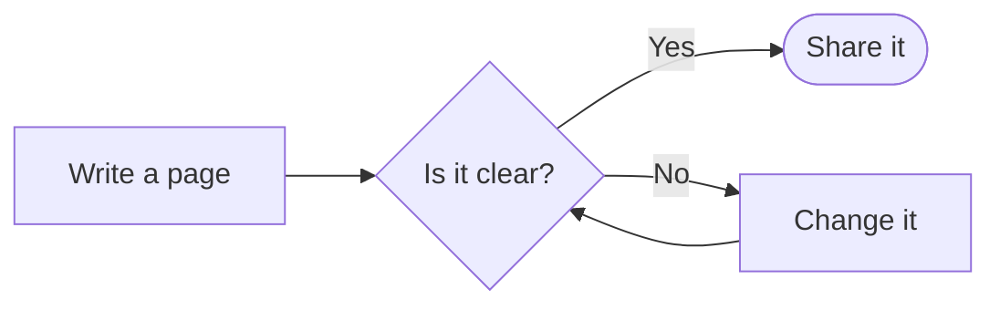

# Kaydown

Kaydown is a Markdown editor made with UI.jl. This page is a Markdown file. Each line is drawn the way it will read, and the markup characters stay out of sight. A line keeps that look while you type in it. To change its markup, **click the line and press ⌘E**, or click Plain at the top right: the part of the page with the caret shows its markup. ⌘E again, or Rich, hides it. Press ⌘S to write your changes to the file.

The page [examples.md](examples.md) lists everything that Kaydown does, with a link to an example of each.

## Text

You can write in **bold**, in *italic* or in ***both***. Use backticks for `code`, and square brackets for [a link](https://github.com/jkroso/UI.jl). Hold ⌘ and click a link to open it. A name like snake_case_name keeps its underscores.

> A line that starts with > is a quote.
> It can run over several lines.

A word that the Mac's dictionary doesn't have, like teh, gets a line of red dots under it. Right-click the word to choose the word you meant. Press ⌘F to find text in the page.

A line can point to a footnote[^note]. The footnote is a line of its own, anywhere in the file, and the page gives each footnote a number. Hold ⌘ and click the number to go to the footnote.

[^note]: This is the footnote. Its line starts with the same name in square brackets, and a colon.

A line that holds only a picture, like ``, shows the picture. Drop a picture on the page from the Finder to add one. Any other file that you drop goes in as a path that you can click. ⌘V does the same with files that you copied in the Finder: a picture, a video, a sound, a PDF or any other file. It also pastes a picture that you copied as itself, like a screenshot. Kaydown keeps the picture as a file in a hidden folder called `.media`, beside the page.

A line that holds only a video file shows a player for it, like ``. To play only part of the video, add the seconds where the part starts and stops to the end of the file's name. `` starts at 1:01 and stops at 1:26. Leave out the second number to play on to the end. To read what was said in the video, move the mouse over it, and click the button under the one that makes it fill the window. The first time, macOS writes down what's said in the file. A line that plays part of a file shows what was said in that part. A button in the drop-down copies the words.

To play a video or a sound faster or slower, move the mouse over its player, and click the small 1× circle on the player's bottom edge. The circle also shows while the file plays. Each click goes to the next speed: 1½×, 2×, ½×, then 1× again. Once you've clicked a player, < and > change the speed by a quarter at a time, the space bar plays and stops, and ← and → go back and on by 5 seconds.

## Lists

1. Press Return at the end of this line. The next number is typed for you.
2. Press Return on an empty item to end the list.
3. Press Tab to move an item in, and shift-Tab to move it back out.

- A long item wraps onto the next line, and the text of that line starts under the text of the first line, not under the bullet.
  - Items can sit inside other items.
- Select some words and press ⌘B or ⌘I.

- [x] An item that starts with `- [x]` has a box with a tick in it.
- [ ] Click the box of an item like this one to tick it.

## Tables

| Keys | What they do |
|------|--------------|
| ⌘O | Finds a file in this folder by name |
| ⌘F | Finds text in the page. Return goes to the next place that has it. |
| ⌘E | Shows the markup of the part of the page that the caret is in, or hides it again |
| ⌘P | Prints the page, or saves it as a PDF |
| ⌘⇧E | Saves the page as a page of HTML, for a website |
| ⌘Return | Sends the page to an agent that waits for it |
| ⌘, | Opens the settings in a window of their own. Press it again to close that window. |
| ⌘W | Closes the window |
| ⌘\ | Shows and hides the list of files |
| ⌘⇧\ | Gives the list of files the keyboard. Press esc to go back to the text. |
| ⌘⇧. | Shows the hidden files in the list of files, or leaves them out again |
| ⌘Z and ⌘⇧Z | Undo and redo |
| ⌥← and ⌥→ | Move the caret a word at a time |
| ⌘+ and ⌘- | Make the text bigger and smaller. ⌘0 puts it back to the size it started at. |

Click a cell and type. Tab goes to the next cell and Return goes down a row. Both add a row when they reach the end of the table.

## Code

```julia
# Only the lines on screen are built
describe(d::Document) = begin
  e = editor(d)
  title = "Lines $(first(e.shown)) to $(last(e.shown))"
  Column(fixed(e.width), spacer(28px), map(describe, e.layout[e.shown])...)
end
```

The line that opens a code block names its language, and the code is coloured to match. Try changing `julia` to `python`.

Julia code runs where it is. Put the caret in a line of the block under this and press ⌘Return. The page runs the line, and shows what it comes to in a box after the line. ⇧Return runs the line and goes to the next one. A box with an arrow has more to show: click it. A box goes when you change its code, and Escape takes every box away.

```julia
width = 2.4
area = width * 3.6
grid = [row * column for row in 1:3, column in 1:4]
```

The page [julia.md](julia.md) has more code to run: an expression of several lines, what code prints, the names that a block offers as you type, and the box of a function.

## Live blocks

A code block in the language `ui` holds Julia code. The page runs the code and shows what it makes: a node from any Julia module, or any other value as text.

```ui
@use "./widgets.jl" Counter
Counter()
```

```ui
@use "./widgets.jl" Meter
Meter(done=0.7)
```

A block can use UI.jl's components and layout with no line that loads them: `Slider`, `STLViewer`, `Column`, `px` and the rest. A file path is `fs"notes.md"` and a colour is `colorant"tomato"`. The two blocks above load `widgets.jl` because it's a file of this folder.

A file path shows as a breadcrumb. Click its last name to list what's in the folder, and click a file in the list to make it the path. Under a file is what's in it: a picture, its text, which you can scroll through, a 3D model that you can drag to turn, a player for a sound or a video, the pages of a PDF, a CSV file as a table, or the picture that the Finder shows for a file like a Word file. Click `knot.stl` to see a model.

```ui
fs"."
```

The caret doesn't go into a block like this one. Move it down the page with ↓, and it goes onto the block as a whole: a line shows round the block. From there:

- Return gives the block the keyboard. In a form, the first field takes it, and Tab goes to the next field. Esc gives the keyboard back to the page.
- ↑ and ↓ go on to the line before the block and the line after it.
- ⌫ takes the block away.
- ⌘E shows the block's code, so you can change it. ⌘E again shows what the code makes.

A click on the block with ⌥ held shows its code too.

Code can run in a line of text too. Write a `!` and then the code between backticks, like \!`fs"."`. This page is in the folder !`fs"."` and its colours are !`page_theme()`. A number works too: 12 × 2.4 is !`12 * 2.4`. Press ⌘E and click a line to see its code.

The page [components.md](components.md) has a live block for each of UI.jl's components: checkboxes, switches, a slider, a menu, a colour picker, a viewer for 3D models, players for sound and video, diagrams, a text field, a tree and an inspector. It shows shadows too. Hold ⌘ and click the link to open it.

## Blocks of your own

A file can define a kind of block. The block below is in the language `progress`, which Kaydown doesn't know. The file `progress.jl` in this page's folder has a function called `progress`. Kaydown gives that function the lines of the block, and shows what it makes.

```progress
done: 0.7
label: Framing
```

Click in the bar, or drag in it, to say how much is done. The file's function `written` gives the new lines, and Kaydown writes them into the block: press ⌘E to see them. ⌘Z takes the change back.

The line that opens a block can name the file after the language, so one file can define many kinds of block: `progress ./widgets.jl`. It can name a repository on GitHub too, like `progress github.com/sam/blocks`. Kaydown asks you before it runs the code of a repository for the first time. Open [progress.jl](progress.jl) to see how a kind of block is written. When you save a change to that file, Kaydown loads it again, and the block above changes with it.

## Sheets

A code block in the language `sheet` works things out. Each row has a name and a Julia expression. An expression can use the names of the rows above it, and numbers can have units.

```sheet
Wall length = 12m
Wall height = 2.4m
Area = wall length * wall height
Coats = 2
Coverage = 16m^2 / litre
Litres = area * coats / coverage
Tins = ceil(litres / 4litre)
```

Click a cell and type. Tab goes to the next cell and Return starts a row. To see the sheet as lines of code, hold ⌥ and click it.

## Spreadsheets

A code block in the language `spreadsheet` is a grid of cells. Each column has a letter and each row has a number, so `B2` is the second cell of the second row. A cell that starts with `=` is a formula: a Julia expression that can use the other cells by name. `D2:D4` is every cell from D2 to D4.

```spreadsheet
| Wall  | Length | Height | Area         |
| North | 12m    | 2.4m   | = B2 * C2    |
| East  | 8m     | 2.4m   | = B3 * C3    |
| South | 12m    | 2.4m   | = B4 * C4    |
| Total |        |        | = sum(D2:D4) |
```

Click a cell and type. A cell shows what its formula comes to, and it shows the formula while the caret is in it. Tab goes to the next cell and Return goes down a row. The bar over the grid adds and removes a row or a column, and each formula still names the same cells after that. To see the spreadsheet as lines of code, hold ⌥ and click it.

## Diagrams

A code block in the language `mermaid` shows a diagram. Its first line says what kind of diagram it is. The lines after that say what's in it: this one has four boxes, and each `-->` is an arrow from one box to the next.



Kaydown draws five kinds of diagram: `flowchart`, `sequenceDiagram`, `stateDiagram-v2`, `classDiagram` and `pie`. They're written in the language of [Mermaid](https://mermaid.js.org), so a diagram from another app shows here too. A kind that Kaydown can't draw yet shows as its code. To see the code of a diagram, hold ⌥ and click it.

A diagram that's too small to read can fill the window. Move the mouse over it, and click the button that shows beside its top right corner, or pinch outwards on it. Then pinch, or scroll with ⌘ held, to make it bigger, and drag it to see the rest. Esc puts the page back. A picture and a page of a PDF file do the same, and a model and a video fill the window too.

## Takeoffs

A code block in the language `takeoff` shows a plan that you measure from: a page of a PDF file, or a picture. Drop the file on the block, or click the block to choose it. This one has the plan of a small house, with its power points and lights counted, a run of cable measured and the kitchen floor measured.

```takeoff
plan: plan.pdf
page: 1
scale: 1:100

count | Double power point
  164.2,483.5 164.2,268.1 308.7,449.5 235.0,242.6 331.4,494.9 436.3,494.9 382.4,364.5 331.4,245.4 436.3,245.4 459.0,494.9
  586.5,426.9 586.5,353.1 461.8,324.8 529.8,245.4 586.5,245.4
count | Ceiling light
  235.0,415.5 382.4,475.0 382.4,324.8 521.3,469.4 481.7,307.8 558.2,307.8
length | Cable to the kitchen | +10%
  161.3,500.6 314.4,500.6 314.4,398.5 382.4,398.5
area | Kitchen floor tiles
  322.9,503.4 444.8,503.4 444.8,356.0 322.9,356.0
```

The buttons at the top left are the tools. With the arrow, click a mark or a line to select it, drag a corner to move it, and press Delete to take it away. The next three tools count, measure a length and measure an area for the measure that's chosen in the list. A count takes a mark for each click. A length and an area take a corner for each click. A Done button shows beside the last corner: click it, or press Return, to end the line or the outline. The ruler sets the scale from a length that you know: click its two ends and type how long it is.

On a PDF plan, a corner snaps to the plan's lines: to the end of a line, to the place where two lines cross, or to the nearest point of a line. A small mark shows where the corner will go. It snaps to the corners of what's already measured too. The magnet turns snapping off, and so does ⌘ while you hold it. A plan that's a picture or a scan has no lines to snap to.

The tool after the area tool cuts a shape out of an area, like a window out of a wall. Draw the outline of the shape over the area. The area's amount is then without the part of the cut-out that's inside it. A cut-out shows as dashes. Select it, move its corners or take it away like any outline. In the block's lines, it's a line that starts with `cut` under the outline that it's cut from.

Turn the mouse wheel, or pinch on the trackpad, to make the plan bigger or smaller round the mouse. Two fingers on the trackpad move the plan, and with ⌘ held they make it bigger or smaller. In the page, the wheel and two fingers scroll the page until you click the plan. A plan that's bigger than its view moves when you drag it. The button with four arrows makes the block fill the window, and Esc puts it back in the page.

Under the plan is the table of measures. **Add a measure** starts a new one and asks what it measures: type a few words that describe it, like "Double power point". Its item is defined later, in Centient. Click a measure to choose it and the tool that draws for it. Click the words of the measure that's chosen to change them. A new measure is what the tool you choose makes it: a count, a length or an area. The `+0%` adds a share for waste. Click the unit after an amount to choose another, like millimetres or feet. The price and the quote's line are in that unit too.

The headings of the table sort and search it. Click **Amount** or **Cost** to sort from low to high, again for high to low, and once more for the order that the block is written in. Click **Item** for a menu with two orders and a field that searches the column. Return keeps the search, and Esc puts back the one before.

If [Centient](https://centient.com.au) is on your Mac, a second button shows under the table. **Add from catalogue** starts a measure for a specific item of Centient's catalogue. Search for the item and choose it. The table then shows the item's name, the catalogue that it's from, its price and what the measure costs. The search looks in your own items first. Press ⌥ in the empty field, or click the foot of the list, for the suppliers whose catalogues Centient holds. Choose one, and the search goes on in its catalogue. The item's unit chooses the tool: a length for an item sold by the metre, an area for one sold by the square metre, and a count for the rest. Click the item of the measure that's chosen to choose another. The columns for the price and the cost show only while a measure has an item.

Choose the customer at the bottom left, and **Make quote in Centient** makes a quote there with a line for each measure. A measure with an item is priced from the catalogue. A measure with only words is a line of those words, which you match to an item and price in Centient. Centient doesn't have to be open.

Every change goes into the block's lines, so the file holds the whole takeoff. To see the lines, hold ⌥ and click the block.

## Schedules

A code block in the language `schedule` plans the page's to-do items. Each item is a task, and the block shows each task as a bar on a line of days. Drag the end of a bar to say how long the task takes, and drag from the circle after a bar to the task that waits for it. On a page with a schedule, the mouse over a to-do item shows the task's days at the end of its line. The page [schedule.md](schedule.md) has one to try.

## Charts

A code block in the language `chart` draws the numbers of a table. It draws the table, the spreadsheet or the sheet that's nearest above it.

| Month | Sales | Costs |
|---|---|---|
| July | $4,200 | $2,900 |
| August | $5,100 | $3,100 |
| September | $4,800 | $3,600 |
| October | $6,300 | $3,900 |

```chart
title: Sales and costs
```

The three buttons at its top make it bars, lines or a pie. Change a number in the table, and the chart changes with it. Move the mouse over a bar to see its number.

A line in the block can say more. `show: Sales` draws only that column. `by: Month` names the column whose words go under the bars. `from: Spreadsheets` draws the first table under that heading. A chart can hold its own rows too, with a `|` between the cells. To see the block's lines, hold ⌥ and click the chart.

## Boards

A code block in the language `board` shows this page's to-do items as cards in columns. Drag a card to another column. A card that you drop on the last column ticks its item, and a card that you drag out of that column takes the tick away. Click a card twice to go to its item.

```board
```

The block's lines hold the column of each card. A line like `columns: Later, This week, Done` at their top names other columns.

## Sketches

A code block in the language `sketch` is a drawing. Choose a tool at its top, and drag in the sketch to draw with it: by hand, a line, an arrow, a box or an oval. For words, click where they start, type them in the field at the top and press Return. The dots choose a colour. With the first tool, click a shape to select it, drag it to move it, and press Delete to take it away.

```sketch
box 60,50 330,190
text 70,38 Bathroom
oval blue 90,80 180,150
text blue 100,174 Basin
box 230,70 310,170
text 240,125 Shower
arrow red 450,80 336,110
text red 458,84 The door opens in
```

Each shape is a line of the block, so ⌘Z takes back the last thing you drew.

## Find

A code block in the language `find` lists the lines that match in every page of this page's folder, and of the folders in it. With nothing in the block, it lists each to-do item that isn't ticked. Click a box to tick the item in its own page. Click an item's words to go to it.

```find
```

Words in the block list the lines that have those words. `what: headings` lists headings, and `what: done items` lists the items that are ticked. `in: jobs` looks only in the folder `jobs`.

## Emails

Once Kaydown has your email account, a code block in the language `email` lists the emails with a person, newest first. Write a name or an address in it. A click opens an email, and the block's buttons start an answer or a new email. To give Kaydown your account, press ⌘, and choose Email.

```email
with: sam@example.com
```

## Recordings

To record from your Mac's microphone, right-click the page and choose Insert › Recording. Kaydown starts to record at once, into a new file in the hidden folder `.media` beside this page. Bars show how loud the sound is, and you can type while it records. Click the red button to stop. The first time, macOS asks whether Kaydown may use the microphone.

A line that holds only a sound file shows a player for it. The line is written as a picture is, like ``. Move the mouse over the player and click Transcribe under it, and macOS writes down what's said in the file. The words go into a paragraph under the player, and you can change them as you would any text. macOS does this on your Mac, so the sound stays there. It needs macOS 26 or later.


## Work with an agent

An agent like Claude Code can write a page and show it to you here: a plan with a diagram, a table of options, a list of boxes to tick. While the agent waits for you, a bell shows at the top right. It's a button called "Nudge Claude". Change the page any way you like: tick a box, change a number, type a question on a new line. Then click the button, or press ⌘Return. Kaydown saves the page and gives the agent the lines that you changed.

An agent can ask a question in a block of its own. Click an answer, or type one in the field, and then send the page. A round mark means that you choose one answer, and a square box means that you choose as many as you like.

```ask
Which should the agent do first?
( ) Write the tests
( ) Fix the bug
[ ] Tell me when it's done
```

An agent can show you its changes to a file too. Accept or reject each one, and send the page. Kaydown changes no file: the agent reads your choices and makes the changes that you accepted.

```changes
--- a/greet.jl
+++ b/greet.jl
@@ -1,3 +1,4 @@
 greet(name) = begin
-  println("Hello ", name)
+  isempty(name) && return
+  println("Hello, ", name, "!")
 end
```

The agent can change the page while you read it. What you're typing stays, and the agent's changes show around it. A bar shows for a few seconds beside each line that the agent changed. If you missed them, click the button with an eye at the top right: it shows a bar beside every line that the agent changed since you last sent the page, until you click it again. In the list of files, a dot marks a page that an agent waits for. While the list is hidden, the dot shows beside the button that opens it. [Kaydown's page on GitHub](https://github.com/jkroso/Kaydown#use-it-with-an-agent) says how to set up an agent.

## Files, menus and settings

The button at the top left shows the files in this folder. Click the icon beside a file to see its headings and its components, such as a slider, a sheet or a spreadsheet. Click one to go to it. Press ⌘⇧\ to use the list with the keyboard: ↑ and ↓ move through it, → and ← show and hide what's under an item, and Return opens a file or goes to a heading.

The list leaves out hidden files and folders, the ones whose names start with a dot, like `.media`. To list them too, click the eye beside the button at the top left, or press ⌘⇧. as you do in the Finder. Click the eye again to leave them out.

Click a file in the list that isn't Markdown to see it in the page. Kaydown shows such a file and never changes it, so the top bar says "Read only". A file of code shows its text, which you can select, copy and search. A picture, a model, a sound, a video, a PDF and a CSV file each show as what they are. Any other file is a binary file, and a button shows its bytes in hexadecimal. The button at the top right opens the file in the app that your Mac uses for it.

Right-click a file in the list to rename it, copy its path, show it in the Finder or move it to the Trash. Right-click the file's name at the top of the window for the same menu.

Right-click the page to cut, copy or paste. The menu's Insert item adds a new block where you clicked: a heading, a list, a to-do item, a table, a sheet, a spreadsheet, a diagram, a takeoff, a schedule, a chart, a board, a sketch, a live block and more.

A file can start with front matter: lines like `title: Notes` between two lines of `---`. Kaydown shows it as a block of its own, and leaves it out of the word count.

Press ⌘, to open the settings in a window of their own: the colours, the font and its weight, the size of the text, the width of the page and what the count at the top right shows. A button there makes Kaydown the app that opens your Markdown files. The tabs at the top of that window show two more pages. Code editor has the settings for code: its font, its weight, its size, its indent, its line numbers and whether a long line wraps. Key bindings has the keys of each command. There you can choose the keys of VS Code, Sublime Text or Emacs, or click a command and press the keys you want for it.

The Kaydown app updates itself. It gets a newer version while you work, and the new version takes the place of this one when you quit. A box at the end of the settings turns that off.
