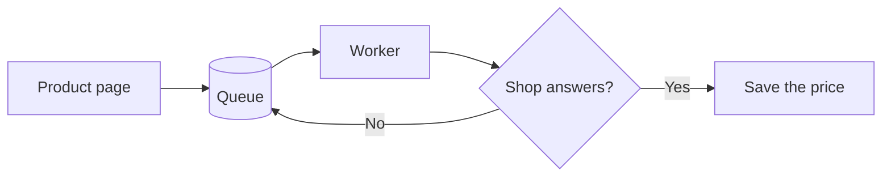

# Show a page in Kaydown

Kaydown is a Markdown app on the user's Mac. It draws a Markdown file as a page: a `mermaid` code block is a diagram, a table is a table, `- [ ]` is a box that the user can tick. The user can type anywhere on the page. A button in Kaydown, "Send to Claude", sends you the lines that the user changed.

So a page does two jobs. It shows the user more than the terminal can. And it is the form that the user answers on.

## The steps

1. Write the page as a Markdown file. Its name must end in `.md`. Put it where the user says. If the user names no place, put it in a `.kaydown` folder in the project.
2. Run `kaydown show <file>`. Kaydown opens the page in front of the other windows.
3. Run `kaydown wait <file>` in the background (in Claude Code: the Bash tool with `run_in_background: true`). Do not poll, and do not run it in the foreground, because the user can take any length of time.
4. Tell the user, in one or two sentences, what is on the page and what you need from them. Tell them to press "Send to Claude" (⌘Return) in Kaydown when they are done. Then end your turn.
5. When `kaydown wait` stops, its output is what the user changed. Read it, and do what it asks.
6. If you change the page, edit the file. Kaydown shows your change in less than a second, so do not run `kaydown show` again.
7. If the work on the page goes on, run `kaydown wait <file>` in the background again. If the work is done, do not. The Send button shows in Kaydown only while a `kaydown wait` runs.

If the user answers in the terminal and not on the page, do what they say. A `kaydown wait` that still runs does no harm.

## What `kaydown wait` prints

```
The user sent /Users/sam/shop/.kaydown/plan.md from Kaydown.

What the user changed since your last version of the file (- is your line, + is the user's):

@@ -17,7 +17,8 @@
 ## Choose one

 - [ ] Use the queue that Postgres has
-- [ ] Add Redis
+- [x] Add Redis
+Can it run on the server we have?
 - [ ] Keep it in memory
```

How to read it:

- It lists only the user's changes. A change that you made to the file is not in it.
- A box that changed from `[ ]` to `[x]` is a choice that the user made.
- A new line that talks to you, like the question above, is a note. Do what it asks, or answer it, and then take the note out of the page.
- Any other changed text is the user's own wording. Keep it. Do not put your wording back.
- "The user changed nothing in it" means that the user read the page and has nothing to add. If the page asked for approval, that is approval.
- If the output ends with "The user selected this text", the user's note or their words in the terminal are about that text.

Exit code 3 means that Kaydown is not installed, or that it is too old to send a page. Tell the user, and carry on in the terminal.

## Change the page while the user reads it

- Read the file again before you change it. The user's changes are in it after they send.
- Make small edits. Do not write the whole file again. The user can be typing in the page while you work, and Kaydown puts your edit and their typing together.
- If you and the user change the same lines at the same time, Kaydown keeps the user's lines. You see their lines the next time they send.

## What a page can have

| To show | Write |
|---------|-------|
| Headings, **bold**, *italic*, `code`, links, quotes, lists, a rule | Markdown, as usual. The headings are also the page's list of contents. |
| A choice or a task | `- [ ] Text`. The user clicks the box. |
| A table | A Markdown table. The user can type in its cells and add rows. |
| A flow, a sequence, states, classes, shares | A `mermaid` code block. See below. |
| Code | A code block with its language. Kaydown colours it. |
| Sums that the user can change | A `sheet` or a `spreadsheet` code block. See below. |
| A picture | `` on a line of its own. The path starts at the page's folder. A web address works too. |
| A footnote | `[^1]` in the text, and a line that starts with `[^1]:`. |
| Another page | A link to another `.md` file. The user holds ⌘ and clicks it. |

Kaydown does not draw HTML tags. Do not use them.

### Diagrams

Kaydown draws five kinds of Mermaid diagram: `flowchart` (or `graph`), `sequenceDiagram`, `stateDiagram-v2`, `classDiagram` and `pie`. Any other kind, like `gantt`, `erDiagram` or `mindmap`, shows as code, so do not use it.

````

````

A flowchart can have `subgraph`, text on a line, and these shapes: `[box]`, `(round)`, `([pill])`, `{diamond}`, `((circle))`, `{{hexagon}}`, `[(drum)]`. A sequence diagram can have `participant`, `actor`, `Note over`, `loop`, `alt` with `else`, and `opt`.

### Sums

A `sheet` is a list of rows. Each row is a name, `=`, and a number or a sum. A sum can use the names of the rows above it. A number can have a unit, like `12m` or `2hr`. Kaydown shows what each row comes to, and the user can change any number.

````
```sheet
Shops = 40
Checks per shop = 600
Seconds per check = 1.5
Hours = shops * checks per shop * seconds per check / 3600
```
````

A `spreadsheet` is a grid. Column letters and row numbers name the cells, and a cell that starts with `=` is a formula.

````
```spreadsheet
| Option   | Days | Cost a day | Cost         |
| Postgres | 2    | 900        | = B2 * C2    |
| Redis    | 3    | 900        | = B3 * C3    |
| Total    |      |            | = sum(D2:D3) |
```
````

### Code that runs

A code block in the language `ui`, and code between backticks straight after a `!`, is Julia code that Kaydown runs when the page opens. Use these only if the user asks for a live block.

## Write a page that is easy to answer

- Put the answer or the decision first, then the detail.
- Give each choice as tick boxes, and say whether the user picks one or many.
- Ask each question on a line of its own, and leave an empty line under it for the answer.
- Use a diagram for how things connect, a table to compare options, and a sheet for numbers that the user may want to change.
