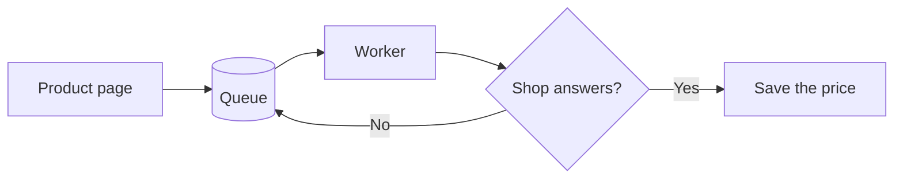

# Show a page in Kaydown

Kaydown is a Markdown app on the user's Mac. It draws a Markdown file as a page: a `mermaid` code block is a diagram, a table is a table, `- [ ]` is a box that the user can tick. The user can type anywhere on the page. A button in Kaydown, a bell at the top right called "Nudge Claude", sends you the lines that the user changed.

So a page does two jobs. It shows the user more than the terminal can. And it is the form that the user answers on.

## The steps

1. Write the page as a Markdown file. Its name must end in `.md`. Put it where the user says. If the user names no place, put it in a `.kaydown` folder in the project.
2. Run `kaydown show <file>`. Kaydown opens the page in front of the other windows.
3. Run `kaydown wait <file>` in the background (in Claude Code: the Bash tool with `run_in_background: true`). Do not poll, and do not run it in the foreground, because the user can take any length of time.
4. Tell the user, in one or two sentences, what is on the page and what you need from them. Tell them to click the bell at the top right of Kaydown, or press ⌘Return, when they are done. Then end your turn.
5. When `kaydown wait` stops, its output is what the user changed. Read it, and do what it asks.
6. If you change the page, edit the file. Kaydown shows your change in less than a second, so do not run `kaydown show` again.
7. If the work on the page goes on, run `kaydown wait <file>` in the background again. If the work is done, do not. The Nudge button shows in Kaydown only while a `kaydown wait` runs.

If the user answers in the terminal and not on the page, do what they say. A `kaydown wait` that still runs does no harm.

## What `kaydown wait` prints

```
The user sent /Users/sam/shop/.kaydown/plan.md from Kaydown.

What the user changed since your last version of the file (- is your line, + is the user's):

@@ -17,7 +17,8 @@
 ## Choose one

 - [ ] Use the queue that Postgres has
-- [ ] Add Redis
+- [x] Add Redis
+Can it run on the server we have?
 - [ ] Keep it in memory
```

How to read it:

- It lists only the user's changes. A change that you made to the file is not in it.
- A box that changed from `[ ]` to `[x]` is a choice that the user made. So is an answer of an `ask` block that changed from `( )` to `(x)`.
- A new line that starts with `>` in an `ask` block is what the user typed as their answer.
- `[accepted]` or `[rejected]` at the end of an `@@` line of a `changes` block is the user's choice for that change.
- A new line that talks to you, like the question above, is a note. Do what it asks, or answer it, and then take the note out of the page.
- Any other changed text is the user's own wording. Keep it. Do not put your wording back.
- "The user changed nothing in it" means that the user read the page and has nothing to add. If the page asked for approval, that is approval.
- If the output ends with "The user selected this text", the user's note or their words in the terminal are about that text.

Exit code 3 means that Kaydown is not installed, or that it is too old to send a page. Tell the user, and carry on in the terminal.

## Change the page while the user reads it

- Read the file again before you change it. The user's changes are in it after they send.
- Make small edits. Do not write the whole file again. The user can be typing in the page while you work, and Kaydown puts your edit and their typing together.
- If you and the user change the same lines at the same time, Kaydown keeps the user's lines. You see their lines the next time they send.

## What a page can have

| To show | Write |
|---------|-------|
| Headings, **bold**, *italic*, `code`, links, quotes, lists, a rule | Markdown, as usual. The headings are also the page's list of contents. |
| A task | `- [ ] Text`. The user clicks the box. |
| A question with answers to choose | An `ask` code block. See below. |
| Changes to a file, to accept or reject | A `changes` code block. See below. |
| Numbers as bars, lines or a pie | A `chart` code block. See below. |
| The page's tasks as cards in columns | A `board` code block. See below. |
| When each task is done, and what it waits for | A `schedule` code block. See below. |
| A table | A Markdown table. The user can type in its cells and add rows. |
| A flow, a sequence, states, classes, shares | A `mermaid` code block. See below. |
| Code | A code block with its language. Kaydown colours it. |
| Sums that the user can change | A `sheet` or a `spreadsheet` code block. See below. |
| A picture | `` on a line of its own. The path starts at the page's folder. A web address works too. |
| A footnote | `[^1]` in the text, and a line that starts with `[^1]:`. |
| Another page | A link to another `.md` file. The user holds ⌘ and clicks it. |

Kaydown does not draw HTML tags. Do not use them.

### Diagrams

Kaydown draws five kinds of Mermaid diagram: `flowchart` (or `graph`), `sequenceDiagram`, `stateDiagram-v2`, `classDiagram` and `pie`. Any other kind, like `gantt`, `erDiagram` or `mindmap`, shows as code, so do not use it.

````

````

A flowchart can have `subgraph`, text on a line, and these shapes: `[box]`, `(round)`, `([pill])`, `{diamond}`, `((circle))`, `{{hexagon}}`, `[(drum)]`. A sequence diagram can have `participant`, `actor`, `Note over`, `loop`, `alt` with `else`, and `opt`.

### Sums

A `sheet` is a list of rows. Each row is a name, `=`, and a number or a sum. A sum can use the names of the rows above it. A number can have a unit, like `12m` or `2hr`. Kaydown shows what each row comes to, and the user can change any number.

````
```sheet
Shops = 40
Checks per shop = 600
Seconds per check = 1.5
Hours = shops * checks per shop * seconds per check / 3600
```
````

A `spreadsheet` is a grid. Column letters and row numbers name the cells, and a cell that starts with `=` is a formula.

````
```spreadsheet
| Option   | Days | Cost a day | Cost         |
| Postgres | 2    | 900        | = B2 * C2    |
| Redis    | 3    | 900        | = B3 * C3    |
| Total    |      |            | = sum(D2:D3) |
```
````

### A schedule

A `schedule` code block shows every `- [ ]` item of the page as a bar on a line of days. The user drags the bars to change the plan, and Kaydown writes each change into the block. The block names each task by the text of its item, without the marks of bold and the like. A task with no line takes one day and starts when the work starts.

````
- [ ] Add the queue table
- [ ] Write the worker
- [ ] Move the price checks to the queue

```schedule
start: 2026-11-16

Add the queue table | 2 days
Write the worker | 3 days | after Add the queue table
Move the price checks to the queue | from 2026-11-25 | after Write the worker
```
````

After the name: `3 days` is how many working days the task takes, `after` and a task's name makes it wait for that task, and `from` and a day is the first day that it can start. A task can have several `after` parts. `start` is the day that the work starts. Saturday and Sunday aren't working days, unless the block has the line `days: every day`. Write a `\` before a `|` in a task's name.

### A question

An `ask` code block asks one question. Its first lines are the question. A line that starts with `( )` is an answer, and the user chooses one of those. A line that starts with `[ ]` is an answer that the user can choose with any others. Under the answers, Kaydown shows a field that the user can type in. A block with no answers is a question that the user answers in that field.

````
```ask
Which queue should the price checks use?
( ) The queue that Postgres has. Nothing new to run.
( ) Redis. Faster, and one more thing to run.
[ ] Keep the old checks running for a week
```
````

The user clicks an answer, and Kaydown writes `(x)` or `[x]` in its line. What they type goes in a line that starts with `>`. Use one block for each question. An older Kaydown shows the block as code, and the user can still type an `x` between the brackets.

### Changes to accept or reject

A `changes` code block holds a diff, as `git diff` or `diff -u` writes one. Kaydown shows each change, with the lines that go in red and the lines that come in green, and an Accept and a Reject button.

````
```changes
--- a/src/queue.js
+++ b/src/queue.js
@@ -10,3 +10,4 @@ function take() {
   const job = next()
-  run(job)
+  if (!job) return
+  run(job)
   done(job)
```
````

Kaydown writes the user's choice at the end of the change's `@@` line: `[accepted]` or `[rejected]`. It changes no file but the page. So show the changes before you make them, and then make only the ones that the user accepted. Give each change that the user can choose apart from the others its own `@@` line.

### A chart

A `chart` code block draws the numbers of a table. With nothing in it, it draws the table, the spreadsheet or the sheet that is nearest above it, as bars. The first column that isn't numbers names the bars, and each column of numbers is drawn.

````
| Month | Sales | Costs |
|---|---|---|
| July | $4,200 | $2,900 |
| August | $5,100 | $3,100 |

```chart
kind: lines
title: Sales and costs
```
````

`kind` is `bars`, `lines` or `pie`. `show: Sales` draws only that column. `by: Month` names the column whose words name the bars. `from: Budget` draws the first table under the heading "Budget". To draw numbers that are in no table, put the rows in the block, under an empty line, with a `|` between the cells and the names of the columns in the first row. Do not draw two measures with different units in one chart.

### A board

A `board` code block shows every `- [ ]` item of the page as a card, in the columns To do, Doing and Done. The user drags a card to another column. A ticked item is in the last column. Kaydown writes a line in the block for each card that is between the first column and the last: the item's text, a `|`, and the column.

````
- [ ] Add the queue table
- [ ] Write the worker

```board
Add the queue table | Doing
```
````

The line `columns: Later, This week, Done` at the top of the block names other columns.

### Code that runs

A code block in the language `ui`, and code between backticks straight after a `!`, is Julia code that Kaydown runs when the page opens. Use these only if the user asks for a live block.

## Write a page that is easy to answer

- Put the answer or the decision first, then the detail.
- Ask each question in an `ask` block. Use `( )` answers when the user picks one, and `[ ]` answers when they can pick many.
- Show changes to code in a `changes` block before you make them, when the user may want only some of them.
- Use a diagram for how things connect, a table to compare options, and a sheet for numbers that the user may want to change.
